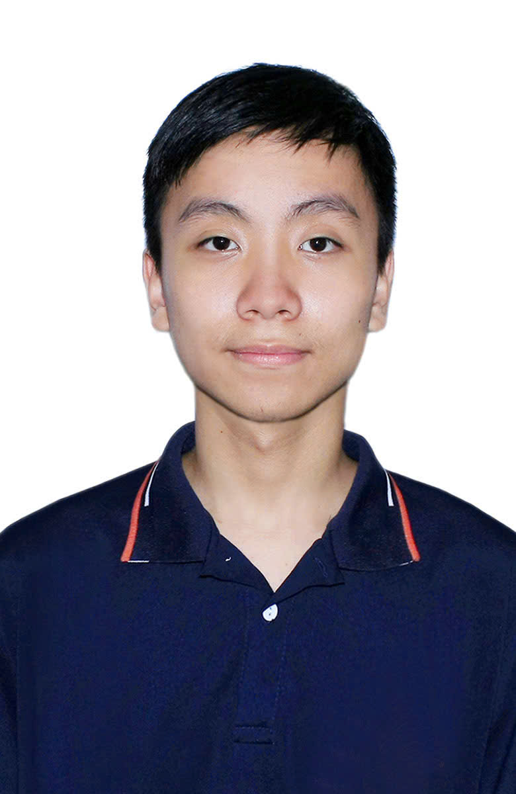
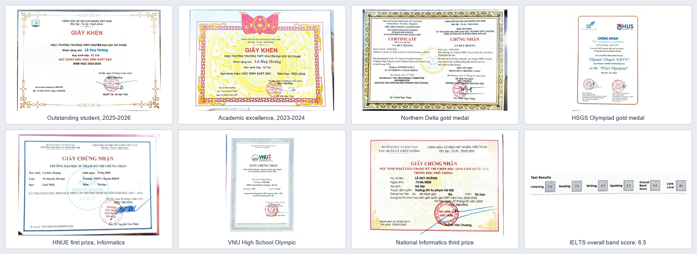

# La Huy Hoang

**Data Science & Artificial Intelligence Student | Competitive Programmer | AI/ML Developer**

📍 Northern Vietnam  
🎓 Hanoi University of Science and Technology (HUST) — DSAI, ITE10  
📧 [lahuyhoang2008@gmail.com](mailto:lahuyhoang2008@gmail.com)  
💻 [GitHub Profile](https://github.com/lahuyhoang2008) | [Kaggle](https://www.kaggle.com/lahuyhoang) | [Codeforces](https://codeforces.com/profile/lahuyhoang) | [VNOI OJ](https://oj.vnoi.info/user/lahuyhoang2008) | [Penwin](https://penwin.io.vn/)

**Date of Birth:** 19/6/2008

<!-- Replace YOUR_IMAGE_URL with a publicly accessible image URL -->

---

## PROFESSIONAL SUMMARY

Data Science and Artificial Intelligence student at Hanoi University of Science and Technology with a strong background in competitive programming and practical AI/ML experimentation.

Experienced in algorithmic problem-solving, deep learning projects, and programming education. Interested in developing machine learning solutions, building educational technology, and applying AI to real-world problems.

## EDUCATION

### Hanoi University of Science and Technology (HUST)
**Data Science and Artificial Intelligence (DSAI) — ITE10**
- Undergraduate student

### High School for Gifted Students, Hanoi National University of Education (HNUE)
**Specialized High School Program**

## HONORS & ACHIEVEMENTS

### International Competition
- 🥉 **Bronze Medal — Central European Olympiad in Artificial Intelligence (CEOAI)**
  - Represented Vietnam in an international AI competition.

### National Competition
- 🥇 **Rank #2** — Northern Vietnam Gifted High Schools Grade 10 Competitive Programming Contest
- 🥇 **Gold Prize** — HSGS Competitive Programming Olympiad
- 🥇 **Gold Prize** — HNUE Competitive Programming Olympiad
- 🥇 **Gold Prize** — VNU Competitive Programming Olympiad
- 🥉 **Third Prize — Vietnam Olympiad in Informatics (VOI)**

### Award & IELTS Evidence

**Overall Band Score: 6.5**

## EXPERIENCE & LEADERSHIP

### Co-founder & Mentor — Penwin
[Website](https://penwin.io.vn/)
- Co-founded and mentored within a programming education initiative.
- Supported programming education and problem-solving skill development.

### Programming Teaching & CodeCamp Activities
- Taught competitive programming to young learners.
- Assisted students during programming bootcamps and CodeCamp activities.

### Vibecode Project — StudyHub
[Live Demo](https://studyhubdemo1-0.onrender.com/)
- Developed an educational web application for creating classroom quizzes and exams from JSON question sets.
- Explored adaptable quiz workflows for subjects such as IELTS, SAT, and Mathematics.

## SELECTED PROJECTS

### StudyHub — Interactive Quiz & Exam Platform
**Focus:** Educational Technology, Web Development
- Enables teachers to import questions from JSON files and generate quizzes or exams.
- Designed for adaptation to different subjects and classroom needs.
- [Try the Live Demo](https://studyhubdemo1-0.onrender.com/)

### AI/ML Projects
**Focus:** Computer Vision, NLP, Deep Learning, Time-Series Modeling
- Experimented with deep learning architectures for computer vision and video classification.
- Explored NLP workflows and machine learning approaches to financial time-series data.
- Focused on model evaluation, experimentation, and generalization.

## TECHNICAL SKILLS

**Programming Languages**
- C, C++, C#, Python

**AI & Machine Learning**
- Deep Learning
- Computer Vision
- Natural Language Processing
- Time-Series Modeling
- Model Evaluation and Optimization

**Core Competencies**
- Competitive Programming and Algorithms
- Problem-Solving
- Programming Education and Mentoring

## AREAS OF INTEREST

- Artificial Intelligence Research
- Quantitative Finance
- Deep Learning Architectures
- Algorithm Design and Optimization

---

*Learn. Build. Compete. Share.*
